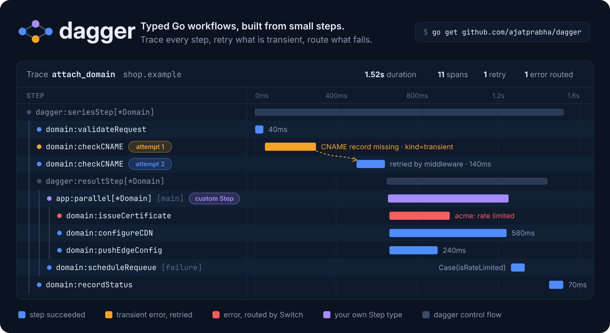
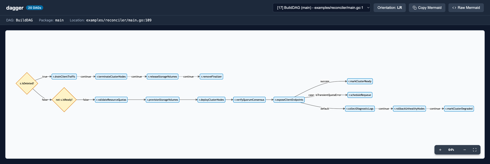

<p align="center">
  
</p>

# dagger

[![test][github-workflow-badge]][github-workflow]
[![codecov][coverage-badge]][codecov]
[![PkgGoDev][pkg-go-dev-badge]][pkg-go-dev]
[![Go Report Card][go-report-card-badge]][go-report-card]

**Build Go workflows from small, typed steps. Then trace them, print them, and review them as a diagram.**

`dagger` is a lightweight Go library for workflows that are **Directed Acyclic Graphs (DAGs)**.
You write each step as a plain Go function.
`dagger` connects the steps with sequence, branch, and error-routing primitives.
You get a workflow that is easy to read, test, observe, and review.

## Why dagger?

- **Flat, declarative flow.** Declare the flow once. Do not write deeply nested `if` and `if err != nil` blocks.
- **Type-safe state.** Go generics (`Step[S]`) carry your state type through all steps. You do not need `any` casts.
- **Validated before it runs.** `dagger.New` rejects cycles and invalid graphs before the first step starts.
- **Observability in one place.** One middleware adds tracing, logs, metrics, or retries to every step.
- **Extensible.** Write your own control-flow step, such as a parallel step.
- **Automatic step names.** `dagger` gets readable names from your functions and methods. Traces and logs use these names.
- **A diagram of your code.** Print the graph as a tree, or open an interactive diagram with the `dagger` CLI.
- **No runtime dependencies.** The library and the CLI use only the Go standard library.

**Good fits:** Kubernetes operators and reconcilers, cloud resource orchestrators, multi-step transactions with rollback, data pipelines, and business workflows.

## Installation

Add the library to your Go module:

```bash
go get github.com/ajatprabha/dagger
```

Install the optional `dagger` CLI to see your DAGs in a browser:

```bash
go install github.com/ajatprabha/dagger/cmd/dagger@latest
```

> [!TIP]
> Make sure that `$(go env GOPATH)/bin` (usually `~/go/bin`) is in your `PATH`.
> Then you can run `dagger` from any directory.

## Quick start

```go
package main

import (
	"context"
	"fmt"
	"log"

	"github.com/ajatprabha/dagger"
)

// 1. Define the workflow state.
type ProvisionState struct {
	ResourceID string
	ClusterIP  string
	Ready      bool
}

// 2. Write each step as a function.
func allocateIP(ctx context.Context, state *ProvisionState) error {
	state.ClusterIP = "10.0.0.42"
	fmt.Printf("Allocated IP: %s\n", state.ClusterIP)
	return nil
}

func verifyHealth(ctx context.Context, state *ProvisionState) error {
	state.Ready = true
	fmt.Println("Health check passed")
	return nil
}

func main() {
	// 3. Compose the steps.
	pipeline := dagger.Series(
		dagger.NewStep(allocateIP),
		dagger.NewStep(verifyHealth),
	)

	// 4. Build the executor. This step validates the graph.
	dag, err := dagger.New(pipeline)
	if err != nil {
		log.Fatalf("Invalid DAG: %v", err)
	}

	// 5. Run the workflow with an initial state.
	state := &ProvisionState{ResourceID: "res-123"}
	if err := dag.Exec(context.Background(), state); err != nil {
		log.Fatalf("Pipeline failed: %v", err)
	}

	fmt.Printf("Resource %s provisioned successfully (Ready=%t)\n", state.ResourceID, state.Ready)
}
```

## Core concepts

| Concept | Type | What it does |
| --- | --- | --- |
| **State** | `S any` | Your own type. Each step gets it to read input and write output. |
| **Step** | `Step[S]` | One unit of work: `Exec(ctx context.Context, state S) error`. |
| **Executor** | `*Executor[S]` | Holds the validated graph and its middleware. Runs the workflow with `Exec`. |

Use `dagger.NewStep` to make a step from a function.
You can also implement `Step[S]` on your own struct.

```go
step := dagger.NewStep(func(ctx context.Context, state *OrderState) error {
    // business logic here
    return nil
})
```

`dagger.New` examines the full graph before the first step runs.
If the graph is not valid, `New` returns `*dagger.ErrInvalid`.
If a step refers to one of its ancestors, the cause is `*dagger.ErrCycle`.

```go
dag, err := dagger.New(rootStep)
if err != nil {
    var cycleErr *dagger.ErrCycle
    if errors.As(err, &cycleErr) {
        log.Fatalf("Graph validation error: %v", cycleErr)
    }
    log.Fatalf("DAG validation failed: %v", err)
}
```

## Control flow

| Primitive | Behavior |
| --- | --- |
| `Series(steps...)` | Runs steps in sequence. Stops at the first error. |
| `Continue(steps...)` | Runs all steps in sequence. Joins all errors with `errors.Join`. |
| `If(sel, step)` | Runs `step` when `sel(state)` is `true`. |
| `IfNot(sel, step)` | Runs `step` when `sel(state)` is `false`. |
| `IfElse(sel, then, else)` | Runs `then` or `else`, based on `sel(state)`. |
| `Result(main, opts...)` | Runs `main`, then routes to `OnSuccess`, `OnError`, or `Switch`. |

A selector is a `Selector[S]`, which is `func(state S) bool`.

### `Series` and `Continue`

Use `Series` for steps that depend on the step before them.
Use `Continue` for cleanup, teardown, or checks where each step must run.

```go
pipeline := dagger.Series(
    dagger.NewStep(fetchUserData),
    dagger.NewStep(validateOrder),
    dagger.NewStep(chargePayment),
)

cleanup := dagger.Continue(
    dagger.NewStep(drainConnections),
    dagger.NewStep(deleteCloudInstances),
    dagger.NewStep(releaseFloatingIP),
    dagger.NewStep(deleteDnsRecord),
)
```

### `If`, `IfNot`, and `IfElse`

```go
isDryRun := func(s *OrderState) bool { return s.Total == 0 }

workflow := dagger.IfElse(
    isDryRun,
    dagger.NewStep(skipPaymentProcessing),
    dagger.NewStep(processCreditCard),
)

promptIfUnpaid := dagger.IfNot(
    func(s *OrderState) bool { return s.Paid },
    dagger.NewStep(promptPayment),
)
```

### `Result`: route on success or error

`Result` runs a main step, then runs a branch based on the outcome:

- `dagger.OnSuccess(step)` runs when the main step returns `nil`.
- `dagger.OnError(step)` runs when the main step returns an error.
- `dagger.Switch(cases...)` matches the error against a list of cases.

> [!NOTE]
> You must give at least one of `OnSuccess`, `OnError`, or `Switch`.
> You can give only `OnSuccess`, only `OnError`, or both.

```go
deployWithNotification := dagger.Result(
    dagger.NewStep(deployService),
    dagger.OnSuccess(dagger.NewStep(sendSlackNotification)),
    dagger.OnError(dagger.NewStep(triggerAlertPager)),
)
```

To read the error in the failure step, use `dagger.NewResultErrStep`:

```go
handleFailure := dagger.NewResultErrStep(func(ctx context.Context, state *OrderState, resErr error) error {
    log.Printf("Payment failed with error: %v", resErr)
    state.Paid = false
    return fmt.Errorf("order %s failed: %w", state.OrderID, resErr)
})

orderStep := dagger.Result(
    dagger.NewStep(chargeCard),
    dagger.OnError(handleFailure),
)
```

When a failure step runs, `Result` returns the error from that step.
If the failure step returns `nil`, the error is suppressed.

To send different errors to different recovery steps, use `Switch` with `Case`.
`DefaultCase` is optional. It runs when no other case matches.
If no case matches, `Result` returns the original error.

```go
isNetworkError := func(ctx context.Context, err error) bool {
    var netErr net.Error
    return errors.As(err, &netErr)
}

isRateLimitError := func(ctx context.Context, err error) bool {
    return errors.Is(err, ErrRateLimited)
}

resilientStep := dagger.Result(
    dagger.NewStep(callExternalAPI),
    dagger.OnSuccess(dagger.NewStep(recordAPISuccess)),
    dagger.Switch[*OrderState](
        dagger.Case(isNetworkError, dagger.NewStep(retryWithExponentialBackoff)),
        dagger.Case(isRateLimitError, dagger.NewStep(queueForDelayedProcessing)),
        dagger.DefaultCase(dagger.NewStep(recordFatalAPIError)),
    ),
)
```

### Custom steps

Any type that implements `Step[S]` is a step.
For a custom step that runs child steps, do these three things:

1. Implement `Unwrap() []dagger.Step[S]`. Then cycle detection and the tree printer see the children.
2. Implement `CanSkipMiddleware() bool` and return `true`. Then middleware can skip the wrapper itself.
3. Wrap each child with your middleware before you run it.
   The middleware from `dag.Use` does not reach the children of a custom step.

This `parallel` step runs its children at the same time and joins their errors:

```go
type parallel[S any] struct {
    mw    dagger.MiddlewareChain[S]
    steps []dagger.Step[S]
}

func (p *parallel[S]) Exec(ctx context.Context, state S) error {
    errs := make([]error, len(p.steps))

    var wg sync.WaitGroup
    for i, step := range p.steps {
        wg.Go(func() { errs[i] = p.mw.Wrap(step).Exec(ctx, state) })
    }
    wg.Wait()

    return errors.Join(errs...)
}

func (p *parallel[S]) Unwrap() []dagger.Step[S] { return p.steps }

func (p *parallel[S]) CanSkipMiddleware() bool { return true }
```

Give the executor and the custom step the same middleware.
The [middleware section](#middleware-and-observability) defines `RetryMiddleware` and `OTelTraceMiddleware`.

```go
mws := []dagger.MiddlewareFunc[*DomainState]{
    RetryMiddleware[*DomainState](3, 200*time.Millisecond, isTransient),
    OTelTraceMiddleware[*DomainState](tracer),
}

provision := &parallel[*DomainState]{
    mw: dagger.NewChain(mws...),
    steps: []dagger.Step[*DomainState]{
        dagger.NewStep(issueCertificate),
        dagger.NewStep(configureCDN),
        dagger.NewStep(pushEdgeConfig),
    },
}

dag.Use(mws...)
```

> [!WARNING]
> The children share one state value.
> Make sure that they do not write the same fields, or protect the fields with a lock.

## Real-world example: a declarative reconciler

Kubernetes operators, database controllers, and cloud cluster managers run reconcile loops.
A DAG keeps a full reconcile loop in one readable function.

This example manages a distributed cluster, such as Redis or Kafka.
It validates the desired state, provisions in steps, recovers from failures with a rollback, and tears down deleted clusters.

```go
type ClusterState struct {
    ClusterID    string
    Namespace    string
    NodeCount    int
    IsDeleted    bool
    IsReady      bool
    StorageClass string
    Endpoints    []string
}

type ClusterReconciler struct {
    k8sClient   KubeClient
    eventLogger EventRecorder
}

func (r *ClusterReconciler) BuildDAG() (dagger.Step[*ClusterState], error) {
    // 1. Provision and scale the cluster.
    provisionSteps := dagger.Series(
        dagger.NewStep(r.validateResourceQuotas),
        dagger.NewStep(r.provisionStorageVolumes),
        dagger.NewStep(r.deployClusterNodes),
        dagger.NewStep(r.verifyQuorumConsensus),
        dagger.NewStep(r.exposeClientEndpoints),
    )

    // 2. Route the result: mark ready, requeue, or roll back.
    provisionWorkflow := dagger.Result(
        provisionSteps,
        dagger.OnSuccess(dagger.NewStep(r.markClusterReady)),
        dagger.Switch[*ClusterState](
            dagger.Case(isTransientQuotaError, dagger.NewStep(r.scheduleRequeue)),
            dagger.DefaultCase(dagger.Continue(
                dagger.NewStep(r.collectDiagnosticLogs),
                dagger.NewStep(r.rollbackUnhealthyNodes),
                dagger.NewStep(r.markClusterDegraded),
            )),
        ),
    )

    // 3. Tear down the cluster. Run all steps, even if one fails.
    teardownWorkflow := dagger.Continue(
        dagger.NewStep(r.drainClientTraffic),
        dagger.NewStep(r.terminateClusterNodes),
        dagger.NewStep(r.releaseStorageVolumes),
        dagger.NewStep(r.removeFinalizer),
    )

    // 4. Top level: delete, or move toward the desired state.
    reconcileDAG := dagger.IfElse(
        func(s *ClusterState) bool { return s.IsDeleted },
        teardownWorkflow,
        dagger.IfNot(
            func(s *ClusterState) bool { return s.IsReady },
            provisionWorkflow,
        ),
    )

    return reconcileDAG, nil
}
```

For a runnable version, see [`examples/reconciler`](examples/reconciler).

## Middleware and observability

A middleware wraps steps to add cross-cutting behavior, such as tracing, logs, metrics, and retries.

```go
type MiddlewareFunc[S any] func(next Step[S], info Info) Step[S]
```

The `Info` struct describes the wrapped step:

- `info.Name` is the step name, for example `controller:*ClusterReconciler.deployClusterNodes`.
- `info.CanSkip` is `true` for internal control-flow steps, such as `Series`, `If`, and `Result`.
  Check it to prevent extra trace spans and log entries for these wrapper steps.

Attach middleware with `dag.Use(...)`, or chain middleware with `dagger.NewChain(...)`:

```go
dag.Use(
    TracingMiddleware(tracer),
    LoggingMiddleware(logger),
)
```

This tracing middleware (OpenTelemetry or Datadog) makes one span for each step.
It propagates the trace context, sets the span status, and records errors:

```go
func OTelTraceMiddleware[S any](tracer trace.Tracer) dagger.MiddlewareFunc[S] {
    return func(next dagger.Step[S], info dagger.Info) dagger.Step[S] {
        return dagger.NewStep(func(ctx context.Context, state S) error {
            if info.CanSkip {
                return next.Exec(ctx, state)
            }

            ctx, span := tracer.Start(ctx, info.Name.String())
            defer span.End()

            err := next.Exec(ctx, state)
            if err != nil {
                span.RecordError(err)
                span.SetStatus(codes.Error, err.Error())
            }
            return err
        })
    }
}
```

<details>
<summary>Retry middleware</summary>

This middleware runs a step again when the error is transient.
Put it before the tracing middleware in `dag.Use`, so that each attempt gets its own span:

```go
func RetryMiddleware[S any](attempts int, backoff time.Duration, retryable func(error) bool) dagger.MiddlewareFunc[S] {
    return func(next dagger.Step[S], info dagger.Info) dagger.Step[S] {
        if info.CanSkip {
            return next
        }

        return dagger.NewStep(func(ctx context.Context, state S) error {
            for attempt := 1; ; attempt++ {
                err := next.Exec(ctx, state)
                if err == nil || attempt == attempts || !retryable(err) {
                    return err
                }

                select {
                case <-ctx.Done():
                    return ctx.Err()
                case <-time.After(backoff):
                }
            }
        })
    }
}
```

</details>

<details>
<summary>Structured logging middleware (<code>log/slog</code> or <code>logr</code>)</summary>

This middleware logs each step with its duration and error:

```go
func SlogMiddleware[S any](logger *slog.Logger) dagger.MiddlewareFunc[S] {
    return func(next dagger.Step[S], info dagger.Info) dagger.Step[S] {
        return dagger.NewStep(func(ctx context.Context, state S) error {
            if info.CanSkip {
                return next.Exec(ctx, state)
            }

            stepName := info.Name.String()
            start := time.Now()

            err := next.Exec(ctx, state)
            duration := time.Since(start)

            if err != nil {
                logger.Error("step failed",
                    slog.String("step", stepName),
                    slog.Duration("duration", duration),
                    slog.Any("error", err),
                )
                return err
            }

            logger.Debug("step finished",
                slog.String("step", stepName),
                slog.Duration("duration", duration),
            )
            return nil
        })
    }
}
```

</details>

<details>
<summary>Metrics middleware (Prometheus or OpenTelemetry)</summary>

This middleware records a duration histogram and an error counter for each step name:

```go
func MetricsMiddleware[S any](histogram metric.Float64Histogram, errorCounter metric.Int64Counter) dagger.MiddlewareFunc[S] {
    return func(next dagger.Step[S], info dagger.Info) dagger.Step[S] {
        return dagger.NewStep(func(ctx context.Context, state S) error {
            if info.CanSkip {
                return next.Exec(ctx, state)
            }

            stepAttr := attribute.String("step", info.Name.String())
            start := time.Now()

            err := next.Exec(ctx, state)
            durationMs := float64(time.Since(start).Milliseconds())

            histogram.Record(ctx, durationMs, metric.WithAttributes(stepAttr))
            if err != nil {
                errorCounter.Add(ctx, 1, metric.WithAttributes(stepAttr))
            }
            return err
        })
    }
}
```

</details>

## Visualize your DAGs

### Interactive visualizer (`dagger` CLI)

The `dagger` CLI finds the DAGs in your code and shows them as interactive Mermaid.js flowcharts in your browser.
It reads your source with the Go AST parser (`go/parser`, `go/ast`).
It does not compile or run your application, and it does not need code generation.



- **Fast reviews.** Reconcilers with many error branches, fallbacks, and rollbacks are hard to follow in code. A diagram shows the flow and the failure paths immediately.
- **Pan and zoom.** Drag to pan, use the wheel to zoom at the cursor, and auto-fit the graph. Keyboard shortcuts: `+`, `-`, `0`, `f`.
- **Mermaid export.** Copy the Mermaid source to the clipboard, or print it to `stdout`. Put it in pull requests, design documents, or Architecture Decision Records (ADRs).
- **Layout toggle.** Switch between top-down (`TD`) and left-to-right (`LR`) layouts.

```bash
# Open the web dashboard (default: http://localhost:8080)
dagger

# Scan a specific directory or package
dagger -dir ./examples/reconciler

# List all discovered DAGs
dagger -list

# Print the Mermaid flowchart of one DAG to stdout
dagger -select BuildDAG -stdout

# Print the flowchart in left-to-right orientation
dagger -select BuildDAG -orientation LR -stdout

# Serve the dashboard on a different address
dagger -serve :9090
```

`-select` accepts a DAG index, a name, or a `file:line` substring.
You can also run the CLI without installing it:

```bash
go run github.com/ajatprabha/dagger/cmd/dagger@latest
```

### Tree printer (`Print`, `PrintString`)

`dagger.Print` writes the graph as a tree to `stdout` or to an `io.Writer`.
`dagger.PrintString` returns the tree as a string.
Use them to log the workflow at startup, to debug a graph, or to assert the layout in unit tests.

```go
fmt.Println(dagger.PrintString(pipeline))
```

```text
dagger:seriesStep[*ClusterState]
    ├── controller:*ClusterReconciler.validateResourceQuotas
    ├── controller:*ClusterReconciler.provisionStorageVolumes
    └── dagger:resultStep[*ClusterState]
        ├── controller:*ClusterReconciler.deployClusterNodes [main]
        ├── controller:*ClusterReconciler.markClusterReady [success]
        └── controller:*ClusterReconciler.rollbackUnhealthyNodes [failure]
```

> [!NOTE]
> Give the root step to the printer, not the `*Executor`.

Options change the output:

```go
dagger.Print(pipeline,
    dagger.WithWriter(os.Stdout), // Custom io.Writer (default: os.Stdout)
    dagger.WithCompactSymbols(),  // Compact ASCII symbols (|- , `- )
    dagger.WithIndent("  "),      // Custom indent string (default: "    ")
    dagger.WithReferences(),      // Add a "(ref)" marker to shared, reused nodes
    dagger.WithoutLabels(),       // Hide the [main], [success], [failure] labels
)
```

To set your own tree symbols, use `dagger.WithSymbols`.

## Step names

`dagger.StepName` uses reflection to get a readable name for each step.
You do not write names by hand.

| Step kind | Format | Example |
| --- | --- | --- |
| Function | `pkg:funcName` | `controller:validateResourceQuotas` |
| Method | `pkg:*Type.Method` | `controller:*ClusterReconciler.deployClusterNodes` |
| Generic step type | `pkg:StepType[StateType]` | `dagger:ifStep[*ClusterState]` |

Traces, logs, the tree printer, and the visualizer use these names.
To set a custom name, implement `dagger.Namer` (`StepName() fmt.Stringer`), or add a `StepName() string` method:

```go
type ProvisionStorageStep struct{}

func (p ProvisionStorageStep) StepName() string {
    return "cluster:provision-storage"
}

func (p ProvisionStorageStep) Exec(ctx context.Context, state *ClusterState) error {
    return nil
}
```

## Documentation

- [Go package documentation][api-docs]
- [Runnable examples](example_test.go)
- [Reconciler example](examples/reconciler)

## License

`dagger` is available under the [Apache License 2.0](LICENSE).

[github-workflow-badge]: https://github.com/ajatprabha/dagger/workflows/test/badge.svg
[github-workflow]: https://github.com/ajatprabha/dagger/actions?query=workflow%3Atest
[coverage-badge]: https://codecov.io/gh/ajatprabha/dagger/branch/main/graph/badge.svg?token=ZGZwbgQBlf
[codecov]: https://codecov.io/gh/ajatprabha/dagger
[pkg-go-dev-badge]: https://pkg.go.dev/badge/github.com/ajatprabha/dagger
[pkg-go-dev]: https://pkg.go.dev/mod/github.com/ajatprabha/dagger?tab=packages
[go-report-card-badge]: https://goreportcard.com/badge/github.com/ajatprabha/dagger
[go-report-card]: https://goreportcard.com/report/github.com/ajatprabha/dagger
[api-docs]: https://pkg.go.dev/github.com/ajatprabha/dagger
